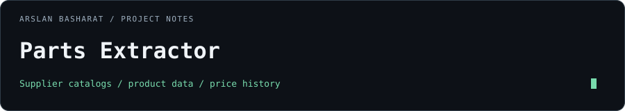

# Parts Extractor



Supplier catalog extraction, product enrichment, and price-history tracking for repair-parts operations.

[Latest release](https://github.com/arslanbasharat-o-o/Scraper/releases/latest) · [Deployment](DEPLOYMENT.md) · [Contributing](CONTRIBUTING.md) · [Security](SECURITY.md)

## What it does

- Collects categories and product details from eight supplier catalogs.
- Supports MobileSentrix US/Canada, XCell Parts, TX Parts US/Canada, Parts4Cells, Phone LCD Parts, and GadgetFix.
- Compares extraction runs with saved data and SQLite-backed history.
- Runs scheduled jobs with resumable checkpoints.
- Uses bounded HTTP-first fetching with browser fallbacks.

## Stack

Python · Flask · SQLite · Scrapling · Browser automation · Linux/systemd

## Get started

The supported production target is Ubuntu/Linux with systemd. Review [DEPLOYMENT.md](DEPLOYMENT.md) before installing.

```bash
git clone https://github.com/arslanbasharat-o-o/Scraper.git
cd Scraper
bash deploy.sh
```

The deployment script prepares the Python environment, checks prerequisites, and installs or restarts `scraper.service`. Configure supplier credentials and proxies in the local `.env` file before running extraction jobs.

[`.env.server-40gb.example`](.env.server-40gb.example) documents the server configuration. Keep populated environment files, catalog credentials, and runtime data outside Git.

## Project map

| Path | Purpose |
| :--- | :--- |
| `app.py` | Dashboard and request handling |
| `automation_service.py` | Scheduled extraction and recovery |
| `database.py` | Persistence and history |
| `scrapers/` | Supplier integrations |
| `data/menu_map_seeds/` | Checked-in category baselines |
| `scripts/` | Operational tooling and diagnostics |
| `tests/` | Automated checks |

## Validate

```bash
python -m pip install -r requirements-dev.txt
python -m py_compile app.py automation_service.py database.py scrapers/*.py
pytest -q
```

## Releases

[`VERSION`](VERSION) records the source version. Release notes are in [CHANGELOG.md](CHANGELOG.md); use [the latest published release](https://github.com/arslanbasharat-o-o/Scraper/releases/latest) for a tagged checkout.

## License

See [LICENSE](LICENSE).
